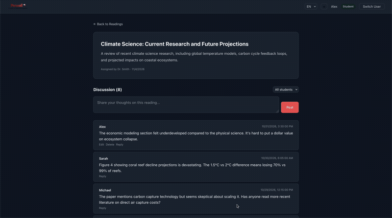

# Perusall Collaborative Reading App

A full-stack collaborative reading application where instructors assign readings and students discuss them through threaded annotations.

Built with TypeScript (strict mode), React, Redux Toolkit, Styled Components (with dark mode and i18n), Vite, Express, Prisma, and SQLite.



## Quick Start

### Prerequisites

- **Node.js** >= 18.x
- **npm** >= 9.x

No external database installation required — SQLite runs embedded.

### Installation

```bash
# Clone the repository
git clone git@github.com:joshuarichard/perusall.git
cd perusall

# Install dependencies
npm install

# Set up the database (run migrations + seed sample data)
npm run db:setup

# Start the development servers
npm run dev
```

The app will be available at:

- **Frontend**: http://localhost:5173
- **API Server**: http://localhost:3001

### Sample Data

Running `npm run db:setup` populates the database with:

- **2 Instructors**: Dr. Smith, Prof. Johnson
- **3 Students**: Sarah, Michael, Alex
- **3 Readings**: machine learning, Shakespeare, and climate science
- **20 Annotations** with **5 replies** and **5 nested replies** demonstrating threaded discussions

To reset the database at any time:

```bash
npm run db:reset
```

## Features

### Exercise Checklist

#### Required

| # | Requirement | Status |
|---|-------------|--------|
| 1 | **Users & Roles** — Support Instructor and Student roles | :white_check_mark: |
| 2 | **Users & Roles** — Select identity to simulate login | :white_check_mark: |
| 3 | **Users & Roles** — Role-appropriate functionality | :white_check_mark: |
| 4 | **Reading Management** — Instructors create readings (title + description) | :white_check_mark: |
| 5 | **Reading Management** — Students browse and select readings | :white_check_mark: |
| 6 | **Reading Management** — Display annotation count per reading | :white_check_mark: |
| 7 | **Reading Management** — Persist readings in the database | :white_check_mark: |
| 8 | **Annotations** — Students add comments to readings | :white_check_mark: |
| 9 | **Annotations** — Display author name and timestamp | :white_check_mark: |
| 10 | **Annotations** — Reverse chronological order | :white_check_mark: |
| 11 | **Annotations** — Display new annotations without page refresh | :white_check_mark: |
| 12 | **Annotations** — Prevent empty annotations, persist all submissions | :white_check_mark: |
| 13 | **Instructor Overview** — Total annotations per reading | :white_check_mark: |
| 14 | **Instructor Overview** — Unique student participation count | :white_check_mark: |
| 15 | **Instructor Overview** — Review all annotations for a reading | :white_check_mark: |
| 16 | **User Experience** — Intuitive navigation for readings and discussions | :white_check_mark: |
| 17 | **User Experience** — Success and error messages | :white_check_mark: |
| 18 | **User Experience** — Graceful empty states | :white_check_mark: |

#### Optional Enhancements

| # | Enhancement | Status |
|---|-------------|--------|
| 1 | **Filtering** — Filter annotations by student | :white_check_mark: |
| 2 | **Editing** — Edit or delete own annotations | :white_check_mark: |
| 3 | **Replies** — Reply to other annotations (unlimited depth) | :white_check_mark: |
| 4 | **Search** — Search readings by title | :white_check_mark: |
| 5 | **Delete Readings** — Instructors delete own readings (cascades annotations) | :white_check_mark: |
| 6 | **Instructor Dashboard** — Aggregate stats, per-reading engagement, student participation with sortable tables | :white_check_mark: |
| 7 | **Testing** — Automated tests (156 across 4 suites) | :white_check_mark: |

#### Above & Beyond

| # | Enhancement | Status |
|---|-------------|--------|
| 1 | **Dark Mode** — System preference detection, manual toggle, localStorage persistence | :white_check_mark: |
| 2 | **Internationalization (i18n)** — Multi-language support (English/Spanish), browser detection, localStorage persistence | :white_check_mark: |
| 3 | **Brand Theming** — Perusall logo and brand color palette across light and dark themes | :white_check_mark: |
| 4 | **Accessibility (a11y)** — WCAG AA contrast, focus indicators, keyboard navigation, ARIA labels, skip link, live regions | :white_check_mark: |

### For Students

- Browse and search readings by title
- View reading details with threaded annotation discussions
- Post annotations and reply to any annotation (unlimited nesting depth)
- Edit and delete own annotations with ownership enforcement
- Filter annotations by author

### For Instructors

- Create new readings with title and description
- Delete own readings with confirmation (cascades to all annotations)
- **Dashboard** with aggregate stats (total readings, annotations, active students), per-reading engagement table, and student participation table — all columns sortable
- View annotation counts per reading
- See unique student participation statistics
- Review all annotations and discussion threads

### UX Details

- Role-based UI — select identity to simulate login
- Dark mode with system preference detection and manual toggle (persisted in localStorage)
- Internationalization (i18n) with English and Spanish, browser language detection, and language dropdown (persisted in localStorage)
- Brand-aligned Perusall color palette (crimson red) across both themes
- Empty state handling for readings, annotations, and search
- Success/error notifications
- Annotations displayed in reverse chronological order with nested reply threads
- Form validation prevents empty submissions
- Shared UI primitives (buttons, cards, forms, empty states) across all pages
- Accessibility: WCAG AA color contrast, visible focus indicators, keyboard-navigable reading cards, skip-to-content link, ARIA live regions for notifications, `aria-label` on all form controls, `html lang` synced to active locale

## Architecture

### Stack Decisions

| Layer            | Choice                    | Why                                                                       |
| ---------------- | ------------------------- | ------------------------------------------------------------------------- |
| **Build Tool**   | Vite                      | Near-instant HMR, native ESM, minimal config                              |
| **UI Framework** | React 18 + TypeScript     | Type safety, component model, ecosystem                                   |
| **State**        | Redux Toolkit + RTK Query | Eliminates Redux boilerplate, built-in API caching and cache invalidation |
| **Styling**      | Styled Components         | Scoped CSS-in-JS, theming support, dynamic styles via props               |
| **Types**        | Shared `shared/types.ts`  | Single source of truth for API wire types across client and server        |
| **Server**       | Express + TypeScript      | Lightweight, familiar, same language as frontend                          |
| **Database**     | SQLite via Prisma 7       | Zero-config, file-based, type-safe queries, driver adapter pattern        |

### Data Model

```
User                 Reading              Annotation
┌──────────────┐     ┌──────────────┐     ┌──────────────┐
│ id           │     │ id           │     │ id           │
│ name         │     │ title        │     │ readingId  ──┼──→ Reading
│ role         │     │ description  │     │ authorId   ──┼──→ User
│ createdAt    │     │ createdBy  ──┼──→  │ parentId   ──┼──→ Annotation (self)
└──────────────┘     │ createdAt    │     │ content      │
                     └──────────────┘     │ createdAt    │
                                          └──────────────┘
```

Annotations support unlimited reply depth via the self-referential `parentId` foreign key. The server builds annotation trees from a flat query using an in-memory Map.

### API Endpoints

| Method   | Endpoint                  | Description                              | Role       |
| -------- | ------------------------- | ---------------------------------------- | ---------- |
| `GET`    | `/api/users`              | List available users                     | Any        |
| `GET`    | `/api/readings`           | List all readings with annotation counts | Any        |
| `POST`   | `/api/readings`           | Create a new reading                     | Instructor |
| `GET`    | `/api/readings/:id`       | Get reading with nested annotation tree  | Any        |
| `POST`   | `/api/annotations`        | Add annotation or reply to a reading     | Student    |
| `PATCH`  | `/api/annotations/:id`    | Edit an annotation (owner only)          | Student    |
| `DELETE` | `/api/annotations/:id`    | Delete an annotation (owner only)        | Student    |
| `DELETE` | `/api/readings/:id`       | Delete a reading and its annotations (owner only) | Instructor |
| `GET`    | `/api/readings/:id/stats` | Reading engagement statistics            | Instructor |
| `GET`    | `/api/dashboard`          | Aggregate dashboard data                 | Instructor |

## Testing

```bash
npm run test             # Run all unit tests (server + client)
npm run test:server      # Server unit tests only
npm run test:client      # Client unit tests only
npm run test:integration # Server integration tests (real SQLite)
npm run test:e2e         # Playwright E2E tests (requires dev servers)
```

**Test breakdown:**

| Suite                    | Count   | Framework                | Approach                                          |
| ------------------------ | ------- | ------------------------ | ------------------------------------------------- |
| Server unit tests        | 36      | Vitest + Supertest       | Mocked Prisma client, colocated with routes       |
| Server integration tests | 47      | Vitest + Supertest       | Real temp SQLite databases, full HTTP stack       |
| Client unit tests        | 59      | Vitest + Testing Library | Component rendering, user interaction, mocked API |
| E2E tests                | 14      | Playwright               | Browser-based flows against running app           |
| **Total**                | **156** |                          |                                                   |
